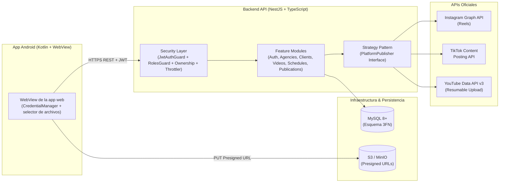

# Documentación de Arquitectura y Seguridad — ContentSync

## 1. Visión General del Sistema

**ContentSync** es una plataforma integral diseñada para agencias de marketing digital que permite subir un video una única vez, gestionar su ciclo de aprobación con el cliente dentro de un cronograma semanal, y publicarlo simultáneamente o de forma programada en **Instagram Reels**, **TikTok** y **YouTube Shorts**.

---

## 2. Arquitectura en Android (WebView)

La aplicación Android (`minSdk = 26`, `targetSdk = 34`) es un WebView de la app web, sin lógica de negocio propia. `MainActivity` aporta lo que la web no puede hacer sola:

- Selector de videos de la galería (`WebChromeClient.onShowFileChooser`).
- Acceso con Google nativo (`CredentialManager`), expuesto a la web por el puente `ContentSyncAndroid`.
- Autorización de YouTube, Instagram y TikTok en el navegador del sistema (`openExternal`), porque los proveedores la bloquean dentro de un WebView. Al volver, la app avisa a la web para refrescar el estado.
- Sesión persistente: el refresh token es una cookie `httpOnly` que `CookieManager` guarda al pasar a segundo plano.

## 3. Arquitectura en Backend (NestJS Modular + Patrón Strategy)

1. **Autenticación Propia OAuth 2.0 + JWT con Rotación de Refresh Tokens:**
   - Contraseñas hasheadas con **Argon2id**.
   - `accessToken` de corta duración (`15m`) y `refreshToken` de `7d` almacenado hasheado en la tabla `auth_sessions` asociado a un `token_family`.
   - **Detección de Reuso (Reuse Detection):** Si un refresh token ya rotado vuelve a presentarse, el backend detecta el compromiso y revoca inmediatamente toda la familia de sesiones del usuario.
   - **Login Social desacoplado de las conexiones de publicación:** El endpoint `POST /api/v1/auth/social` vincula cuentas de Google, Facebook y GitHub por email en `social_auth_accounts`, mientras que los tokens OAuth para publicar en redes de cada cliente viven en `platform_connections` cifrados con **AES-256-GCM** (`CryptoService`).
2. **Control de Acceso Basado en Roles (RBAC) y Propiedad del Recurso:**
   - `ADMIN_GENERAL`: Acceso total a agencias, clientes, cronogramas y auditoría.
   - `AGENCIA`: `ClientsService.assertClientAccess` garantiza en base de datos que una agencia jamás pueda consultar, editar ni publicar sobre clientes de otra agencia.
   - `CLIENTE`: Restringido exclusivamente a sus propios cronogramas y videos; puede aprobar (`APPROVED`), pedir cambios (`CHANGES_REQUESTED`) o rechazar (`REJECTED`) dejando comentarios.
3. **Patrón Strategy para Integración de Plataformas (`PlatformPublisher`):**
   - La interfaz `PlatformPublisher` define `publishVideo(payload)` y `refreshAccessToken(refreshToken)`.
   - Implementaciones concretas: `InstagramReelsPublisher`, `TikTokVideoPublisher` y `YouTubeShortsPublisher`.
   - Para agregar una cuarta red social en el futuro basta con crear una clase que implemente `PlatformPublisher` y registrarla en `PlatformsService`.
