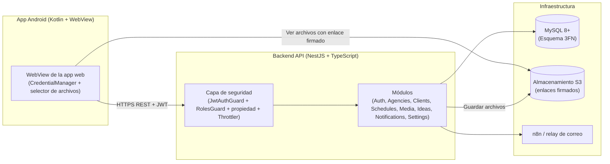

# Documentación de Arquitectura y Seguridad — ContentSync

## 1. Visión General del Sistema

**ContentSync** conecta a agencias de marketing con sus clientes para comunicarse, pedir revisiones, confirmar cronogramas y tener todo organizado. No se conecta con redes sociales ni publica contenido: la agencia lo publica por su cuenta una vez que el cliente lo aprueba.

## 2. Flujo de trabajo

1. **La agencia crea el cronograma** de una semana (lunes a viernes) para un cliente que confirmó "Sí, soy yo".
2. **Agrega bloques de contenido.** Cada bloque tiene:
   - Tipo: reel, carrusel, historia, publicación, video u otro.
   - Título, contenido (de qué trata), texto de la publicación, día y hora prevista.
   - Hasta 20 fotos o videos, cada uno con su descripción y en el orden elegido.
3. **El cliente revisa** cada bloque: lo aprueba, pide cambios o lo rechaza. Pedir cambios o rechazar exige un comentario.
4. **Ambos conversan** con comentarios en cada bloque. Cada comentario le avisa a la otra parte.
5. **El cliente confirma el cronograma.** No se puede con cambios pendientes; lo que siga en revisión queda aprobado. Se registra quién y cuándo.

**Lo aprobado no se desactualiza en silencio:** si la agencia cambia algo que el cliente ve, el bloque vuelve a revisión y una semana confirmada se reabre. El color del bloque no cuenta, porque es solo de organización.

## 3. Arquitectura en Android (WebView)

La aplicación Android (`minSdk = 26`, `targetSdk = 34`) es un WebView de la app web, sin lógica de negocio propia. `MainActivity` aporta lo que la web no puede hacer sola:

- Selector de fotos y videos de la galería (`WebChromeClient.onShowFileChooser`).
- Acceso con Google nativo (`CredentialManager`), expuesto a la web por el puente `ContentSyncAndroid`.
- Sesión persistente: el refresh token es una cookie `httpOnly` que `CookieManager` guarda al pasar a segundo plano.

## 4. Arquitectura en Backend (NestJS modular)

1. **Autenticación propia con JWT y rotación de refresh tokens:**
   - Contraseñas hasheadas con **Argon2id**.
   - `accessToken` de corta duración (`15m`), solo en memoria, y `refreshToken` en cookie `httpOnly`, guardado hasheado en `auth_sessions`.
   - **Detección de reuso:** si un refresh token ya rotado vuelve a presentarse, se revoca toda su familia de sesiones.
   - **Login social:** `POST /api/v1/auth/social` vincula cuentas de Google, Facebook y GitHub por correo.
2. **Control de acceso por rol y propiedad del recurso:**
   - `ADMIN_GENERAL`: acceso total. Su cuenta no se puede eliminar.
   - `AGENCIA`: `ClientsService.assertClientAccess` garantiza que nunca acceda a clientes de otra agencia. Edita cronogramas y comenta, pero no puede aprobar su propio contenido.
   - `CLIENTE`: solo ve sus cronogramas. Revisa, comenta y confirma; no los edita.
3. **Archivos (`MediaModule`, `StorageService`):**
   - El formato se identifica por los primeros bytes del archivo, no por el nombre ni el tipo declarado. Se aceptan JPG, PNG, WEBP, GIF, MP4, MOV y WebM.
   - Un archivo en S3 solo puede referenciarse desde la carpeta de su cliente.
   - Se ven con enlaces firmados que vencen a las 12 horas, así que el bucket puede ser privado.
   - Al quitar un archivo o eliminar un bloque, se borra del almacenamiento salvo que otro bloque lo use, como pasa al duplicar una semana.
4. **Ajustes editables (`SettingsModule`):** nombre de la app, registro de agencias, zona horaria y vigencias de códigos e invitaciones. Se guardan en MySQL y se aplican sin reiniciar.
