# Documentación de Arquitectura y Seguridad — ContentSync

## 1. Visión General del Sistema

**ContentSync** es una plataforma integral diseñada para agencias de marketing digital que permite subir un video una única vez, gestionar su ciclo de aprobación con el cliente dentro de un cronograma semanal, y publicarlo simultáneamente o de forma programada en **Instagram Reels**, **TikTok** y **YouTube Shorts**.

```mermaid
flowchart LR
    subgraph Android["App Android (Kotlin + Compose + Material 3)"]
        UI["Presentation Layer\n(MVVM + StateFlow + WindowSizeClass)"]
        DOM["Domain Layer\n(UseCases + Pure Models)"]
        DATA["Data Layer\n(Repository + Room + EncryptedPrefs + WorkManager)"]
        UI --> DOM --> DATA
    end

    subgraph Backend["Backend API (NestJS + TypeScript)"]
        GUARD["Security Layer\n(JwtAuthGuard + RolesGuard + Ownership + Throttler)"]
        MOD["Feature Modules\n(Auth, Agencies, Clients, Videos, Schedules, Publications)"]
        STRAT["Strategy Pattern\n(PlatformPublisher Interface)"]
        GUARD --> MOD --> STRAT
    end

    subgraph Infra["Infraestructura & Persistencia"]
        PG[("PostgreSQL 16\n(Esquema 3FN)")]
        REDIS[("Redis 7 + BullMQ\n(Cola Programada)")]
        S3[("S3 / MinIO\n(Presigned URLs)")]
    end

    subgraph External["APIs Oficiales"]
        IG["Instagram Graph API\n(Reels)"]
        TT["TikTok Content\nPosting API"]
        YT["YouTube Data API v3\n(Resumable Upload)"]
    end

    DATA -->|HTTPS REST + JWT| GUARD
    DATA -->|PUT Presigned URL| S3
    MOD --> PG
    MOD --> REDIS
    STRAT --> IG
    STRAT --> TT
    STRAT --> YT
```

---

## 2. Arquitectura en Android (MVVM + Clean Architecture)

La aplicación Android (`minSdk = 26`, `targetSdk = 34`) está dividida en tres capas desacopladas e inyectadas con **Dagger Hilt**:

1. **Capa de Dominio (`com.contentsync.app.domain`):**
   - Modelos inmutables (`UserSession`, `AgencyItem`, `ClientItem`, `WeeklyScheduleItem`, `VideoItem`, `PlatformPublicationState`).
   - Interfaces de repositorio (`ContentSyncRepository`) basadas en `Flow`.
   - Casos de uso atómicos (`ValidateVideoForPlatformsUseCase`) que validan política de contraseña fuerte, especificaciones técnicas de video por red social y bloqueo de publicación si el video no está aprobado.
2. **Capa de Datos (`com.contentsync.app.data` y `com.contentsync.app.core`):**
   - `SecureSessionStorage`: Guarda `accessToken` y `refreshToken` cifrados con **Android Keystore (`EncryptedSharedPreferences` AES256-GCM)** y preferencias de tema en **Jetpack DataStore**.
   - `ContentSyncDatabase`: Base de datos local **Room** (`CachedVideoDao`) para caché offline.
   - `ContentSyncApiService`: Cliente **Retrofit + OkHttp** con `JwtAuthInterceptor` y `TokenRefreshAuthenticator` para renovación transparente ante expiración.
   - `ResumableVideoUploadWorker`: Tarea en segundo plano con **WorkManager + HiltWorker** para subida reanudable de videos hacia URLs prefirmadas S3.
3. **Capa de Presentación (`com.contentsync.app.presentation`):**
   - `MainViewModel`: Único punto de coordinación de estado (`StateFlow<ContentSyncUiState>`) sin lógica de negocio en los Composables.
   - `ContentSyncAdaptiveShell`: Adapta automáticamente la navegación usando `WindowSizeClass` (**Bottom Navigation Bar** en teléfonos verticales y **Navigation Rail** en tablets u orientación horizontal) y oculta/muestra secciones según el rol RBAC.

---

## 3. Arquitectura en Backend (NestJS Modular + Patrón Strategy)

1. **Autenticación Propia OAuth 2.0 + JWT con Rotación de Refresh Tokens:**
   - Contraseñas hasheadas con **Argon2id**.
   - `accessToken` de corta duración (`15m`) y `refreshToken` de `7d` almacenado hasheado en la tabla `auth_sessions` asociado a un `token_family`.
   - **Detección de Reuso (Reuse Detection):** Si un refresh token ya rotado vuelve a presentarse, el backend detecta el compromiso y revoca inmediatamente toda la familia de sesiones del usuario.
   - **Login Social desacoplado de las conexiones de publicación:** El endpoint `POST /api/v1/auth/social` vincula cuentas de Google, Facebook y GitHub por email en `social_auth_accounts`, mientras que los tokens OAuth para publicar en redes de cada cliente viven en `platform_connections` cifrados con **AES-256-GCM** (`CryptoService`).
2. **Control de Acceso Basado en Roles (RBAC) y Propiedad del Recurso:**
   - `ADMIN_GENERAL`: Acceso total a agencias, clientes, cronogramas y auditoría.
   - `AGENCIA`: `ClientsService.assertClientAccess` garantiza en base de datos que una agencia jamás pueda consultar, editar ni publicar sobre clientes de otra agencia.
   - `CLIENTE`: Restringido exclusivamente a sus propios cronogramas y videos; puede aprobar (`APPROVED`), pedir cambios (`CHANGES_REQUESTED`) o rechazar (`REJECTED`) dejando comentarios.
3. **Patrón Strategy para Integración de Plataformas (`PlatformPublisher`):**
   - La interfaz `PlatformPublisher` define `publishVideo(payload)` y `refreshAccessToken(refreshToken)`.
   - Implementaciones concretas: `InstagramReelsPublisher`, `TikTokVideoPublisher` y `YouTubeShortsPublisher`.
   - Para agregar una cuarta red social en el futuro basta con crear una clase que implemente `PlatformPublisher` y registrarla en `PlatformsService`.
