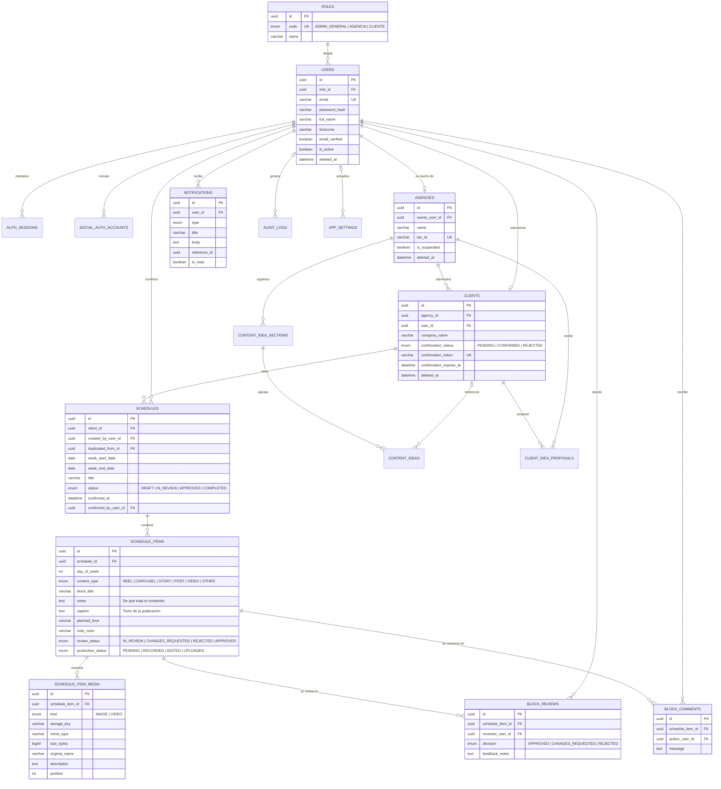

# Diagrama Entidad-Relación y Normalización en 3FN — ContentSync

## 1. Justificación de Formas Normales (1FN, 2FN y 3FN)

El esquema relacional de **ContentSync** en MySQL está normalizado hasta la tercera forma normal.

### Primera Forma Normal (1FN) — Atomicidad y ausencia de grupos repetitivos
- **Regla:** todos los atributos contienen valores atómicos, sin listas ni grupos repetitivos.
- **Aplicación en ContentSync:**
  - Las fotos y los videos de un bloque no se guardan en una lista dentro de `schedule_items`: cada archivo es una fila de `schedule_item_media`, con su descripción y su posición.
  - Las revisiones y los comentarios tampoco: cada uno es una fila de `block_reviews` o `block_comments`.

### Segunda Forma Normal (2FN) — Dependencia funcional completa de la clave primaria
- **Regla:** cumple 1FN y todo atributo no clave depende de la clave completa.
- **Aplicación en ContentSync:**
  - Cada tabla usa una clave primaria simple (`id`), así que no hay dependencias parciales.
  - La clave candidata compuesta `(client_id, week_start_date)` de `schedules` identifica una semana: `title` y `status` dependen de la semana completa, no solo del cliente ni solo de la fecha.

### Tercera Forma Normal (3FN) — Ausencia de dependencias transitivas
- **Regla:** cumple 2FN y ningún atributo no clave depende de otro atributo no clave.
- **Aplicación en ContentSync:**
  - **Roles y usuarios:** `users` guarda `role_id`; el nombre y la descripción del rol viven en `roles`.
  - **Jerarquía agencia → cliente → cronograma → bloque → archivo:** cada tabla referencia solo a su padre inmediato. `schedules` no guarda `agency_id`: se obtiene a través de `clients`.
  - **Tipo de archivo:** `schedule_item_media` guarda `mime_type` y `kind` porque el servidor los fija al validar el archivo, y no dependen de otra columna de datos.
  - **Datos personales:** el nombre y el correo de quien comenta viven en `users`; `block_comments` solo guarda `author_user_id`.

---

## 2. Diagrama Entidad-Relación (Mermaid)

Las tablas `auth_sessions`, `social_auth_accounts`, `content_idea_sections`, `content_ideas`, `client_idea_proposals`, `audit_logs` y `app_settings` se omiten en el detalle de columnas. Su definición completa está en [`backend/prisma/schema.prisma`](../backend/prisma/schema.prisma).
