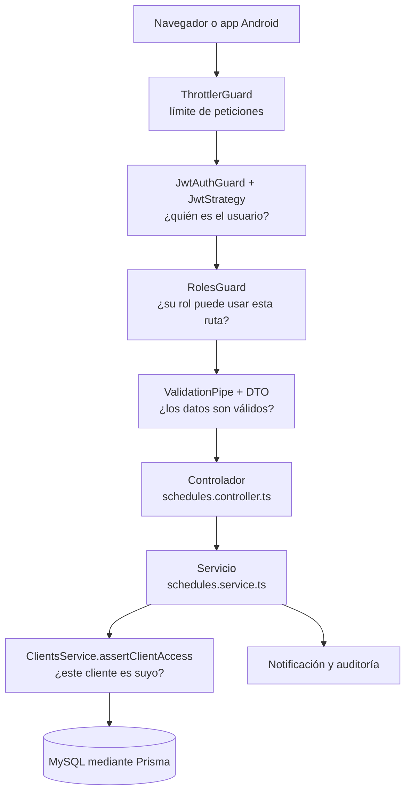

# Guía de archivos de ContentSync

Esta guía explica qué hace cada archivo del proyecto y cómo se relacionan entre sí. Sirve como mapa para ubicarse: el detalle de cada función está en los comentarios dentro de cada archivo.

Para el qué y el porqué del producto, consultá el [README](../README.md) y la [arquitectura](architecture.md).

## 1. Las tres piezas del proyecto

| Pieza | Carpeta | Qué es |
| :--- | :--- | :--- |
| **Backend** | `backend/src/`, `backend/prisma/` | API REST en NestJS. Contiene toda la lógica de negocio y la seguridad, y se conecta a MySQL. |
| **Web** | `backend/public/index.html` | La interfaz completa, en un solo archivo. El propio backend la sirve. |
| **App Android** | `android/` | Un WebView que muestra la web. Solo agrega lo que el navegador no puede hacer solo. |

## 2. Cómo está organizado el backend

Cada funcionalidad es un **módulo**, y casi todos repiten el mismo patrón:

| Archivo | Responsabilidad |
| :--- | :--- |
| `*.module.ts` | Declara qué piezas forman el módulo y cuáles comparte con otros. |
| `*.controller.ts` | Define las rutas HTTP. Recibe la petición y llama al servicio. |
| `*.service.ts` | Contiene la lógica de negocio y las consultas a la base de datos. |
| `dto/*.dto.ts` | Define y valida los datos que llegan en cada petición. |
| `*.spec.ts` | Pruebas automáticas. No forman parte de la aplicación en producción. |

### Recorrido de una petición

Este es el camino de una petición, por ejemplo cuando un cliente aprueba un bloque:

Si algo falla, el recorrido se corta y se responde con un error. Los errores de la base de datos los traduce `prisma-exception.filter.ts`.

## 3. Archivos de la raíz

| Archivo | Qué hace |
| :--- | :--- |
| `README.md` | Presentación del proyecto y cómo ejecutarlo. |
| `CHANGELOG.md` | Historial de versiones. |
| `.env.example` | Plantilla de variables de entorno. Se copia a `.env`. |
| `.gitignore` | Archivos que Git no debe guardar. |
| `docker-compose.yml` | Levanta MySQL y el backend juntos (MinIO es opcional). |
| `render.yaml` | Despliegue en la plataforma Render. |
| `contentsync_mysql.sql` | Crea la base completa de una vez, por ejemplo desde MySQL Workbench. |
| `ContentSync.apk` | App Android ya compilada. |
| `.github/workflows/ci.yml` | Pruebas y compilación automáticas en GitHub. |

## 4. Backend: `backend/`

### Configuración

| Archivo | Qué hace |
| :--- | :--- |
| `package.json` | Dependencias y comandos del proyecto (ver [sección 8](#8-archivos-que-no-llevan-comentarios)). |
| `package-lock.json` | Versiones exactas de las dependencias. Se genera solo. |
| `tsconfig.json` | Opciones del compilador de TypeScript. |
| `tsconfig.build.json` | Excluye pruebas y seed de la compilación final. |
| `nest-cli.json` | Configuración de la herramienta de NestJS. |
| `.eslintrc.js` | Reglas de revisión automática del código. |
| `Dockerfile` | Construye la imagen de Docker. |
| `.dockerignore` | Archivos que no entran en la imagen. |
| `test/jest-e2e.json` | Configuración de las pruebas de integración. |
| `test/app.e2e-spec.ts` | Pruebas de integración de la API. |

### Arranque y configuración: `src/`

| Archivo | Qué hace |
| :--- | :--- |
| `main.ts` | Punto de entrada. Aplica la seguridad HTTP, sirve la web y arranca el servidor. |
| `app.module.ts` | Módulo raíz. Reúne todos los módulos y registra las protecciones globales. |
| `config/env.validation.ts` | Valida las variables de entorno al arrancar. |
| `config/app-config.service.ts` | Único punto de lectura de esas variables. |
| `config/app-config.module.ts` | Comparte configuración, correo y OAuth con toda la aplicación. |

### Piezas compartidas: `src/common/`

| Archivo | Qué hace |
| :--- | :--- |
| `audit/audit.service.ts` | Registra quién hizo qué, en la tabla `audit_logs`. |
| `decorators/auth.decorators.ts` | `@Public()`, `@Roles()` y `@CurrentUser()`. |
| `decorators/auth-throttle.decorator.ts` | `@AuthThrottle()`: límite estricto de peticiones. |
| `filters/prisma-exception.filter.ts` | Traduce errores de la base de datos a respuestas claras. |
| `guards/auth-rbac.guards.ts` | `JwtAuthGuard` y `RolesGuard`: controlan el acceso a las rutas. |
| `interceptors/refresh-cookie.interceptor.ts` | Mueve el refresh token a una cookie que JavaScript no puede leer. |
| `mail/mail.service.ts` | Envía correos por n8n, relay HTTPS o SMTP, en cascada. |
| `prisma/prisma.service.ts`, `prisma.module.ts` | Conexión a MySQL. |
| `utils/html.ts` | Escapa texto de usuarios antes de insertarlo en correos HTML. |
| `utils/oauth-state.service.ts` | Protege el flujo de acceso con Facebook y GitHub. |
| `utils/timezone.ts` | Valida zonas horarias. |

### Módulos de negocio: `src/modules/`

| Módulo | Qué resuelve | Archivos destacados |
| :--- | :--- | :--- |
| `auth/` | Registro, login, acceso social, recuperación de contraseña y sesiones. | `auth.service.ts`: lógica principal. `jwt.strategy.ts`: valida el token. `social-token-verifier.service.ts`: verifica con cada proveedor. `account-deletion.service.ts`: elimina la cuenta propia. |
| `agencies/` | Administración de agencias. Solo para `ADMIN_GENERAL`. | `agencies.service.ts` |
| `clients/` | Alta de clientes y confirmación "Sí, soy yo". | `clients.service.ts`: incluye `assertClientAccess`, la barrera entre agencias. |
| `schedules/` | **Núcleo del producto:** semanas, bloques, revisión, comentarios y confirmación. | `schedules.service.ts` |
| `ideas/` | Banco privado de ideas y propuestas de los clientes. | `ideas.service.ts`, `idea-proposals.service.ts` |
| `media/` | Subida de fotos y videos. | `media.controller.ts` |
| `storage/` | Guarda archivos en S3 o en disco y reconoce su formato real. | `storage.service.ts`, `media-format.ts` |
| `notifications/` | Avisos internos de la aplicación. | `notifications.service.ts` |
| `settings/` | Ajustes editables sin reiniciar el servidor. | `settings.service.ts`, `settings.defaults.ts` |

### Base de datos: `prisma/`

| Archivo | Qué hace |
| :--- | :--- |
| `schema.prisma` | Define todas las tablas, sus campos y sus relaciones. |
| `seed.ts` | Carga datos de demostración. Se niega a correr en producción. |
| `deploy.js` | Aplica las migraciones pendientes antes de arrancar el servidor. |
| `migrations/` | Historial de cambios de la base. Ver la tabla siguiente. |

Cada migración es un cambio de la base de datos, y se aplican en orden de fecha:

| Migración | Qué cambia |
| :--- | :--- |
| `20261022000000_init_3nf_schema` | Crea el esquema inicial completo. |
| `20261104000000_audit_hardening` | Refuerza la seguridad: vencimiento e intentos de códigos, vencimiento de invitaciones, ajustes editables y restricciones `CHECK`. Los códigos pasan a guardarse como HMAC. |
| `20261104010000_drop_bull_job_id` | Quita una columna que quedó sin uso al retirar BullMQ. |
| `20261106000000_collaboration_workspace` | ContentSync deja de publicar en redes y pasa a ser un espacio de trabajo. El bloque es ahora la unidad de revisión, con tipo de contenido y varios archivos. |
| `20261106120000_week_status_and_cleanup` | Las semanas pasan a ser de lunes a domingo, se agrega el estado de producción y se quita el registro de duplicaciones. |
| `20261106180000_client_idea_proposals` | Agrega la tabla de ideas propuestas por los clientes. |
| `20261106190000_profile_setup` | Agrega el aviso para que las cuentas sociales completen sus datos. |

### Web: `public/`

| Archivo | Qué hace |
| :--- | :--- |
| `index.html` | Toda la interfaz: diseño, pantallas y lógica. Ver la [sección 5](#5-cómo-funciona-la-web). |
| `ContentSync.apk` | Copia de la app Android, disponible para descargar desde el servidor. |
| `uploads/videos/.gitkeep` | Archivo vacío que conserva la carpeta de subidas en Git. |

## 5. Cómo funciona la web

`index.html` no usa ningún framework. Todo se apoya en una idea simple:

1. Los datos viven en un único objeto, `state`.
2. Una acción del usuario cambia `state` y llama a `render()`.
3. `render()` vuelve a generar el HTML y lo coloca en `
`.

Dentro del script, el código está dividido en estas secciones, en este orden:

| Sección | Contenido | Funciones clave |
| :--- | :--- | :--- |
| Estado y constantes | Datos globales y catálogos. | `state` |
| Utilidades | Escapado de texto, fechas y avisos. | `esc`, `setBanner` |
| Cliente HTTP | Llamadas a la API y renovación de la sesión. | `apiFetch`, `refreshSession`, `hydrateFromApi` |
| Autenticación | Ingreso, registro, acceso social y recuperación. | `performLogin`, `performRegister` |
| Acciones | Lo que hace cada botón: cronograma, ideas y clientes. | `submitBlockModal`, `submitBlockReview` |
| Pantallas | Funciones `render...` que generan el HTML. | `renderSchedulesScreen`, `renderIdeasScreen` |
| Motor | Dibujo general y arranque de la página. | `render`, `bootStudio` |

## 6. App Android: `android/`

| Archivo | Qué hace |
| :--- | :--- |
| `app/src/main/java/.../MainActivity.kt` | La única pantalla: el WebView, el selector de archivos y las pantallas de carga y error. |
| `app/src/main/java/.../presentation/auth/GoogleSignIn.kt` | Acceso con Google nativo. |
| `app/src/main/AndroidManifest.xml` | Permisos, tema y pantalla principal. |
| `app/src/main/res/values/strings.xml`, `themes.xml` | Nombre de la app y tema base. |
| `app/build.gradle.kts` | Versiones, URL de la web, firma del APK y dependencias. |
| `app/proguard-rules.pro` | Evita que la compilación Release elimine el puente con la web. |
| `build.gradle.kts`, `settings.gradle.kts`, `gradle.properties` | Configuración general de Gradle. |
| `keystore.properties.example` | Plantilla de los datos de firma del APK. |
| `gradlew`, `gradlew.bat`, `gradle/wrapper/*` | Permiten compilar sin tener Gradle instalado. |

La web y la app se comunican a través del objeto `window.ContentSyncAndroid`. Por ejemplo, el botón de Google de la web llama a `signInWithGoogle()`, y Android devuelve el token a `window.__onAndroidGoogleToken`.

## 7. Dónde buscar cada cosa

| Quiero... | Mirá en |
| :--- | :--- |
| Agregar o cambiar una ruta de la API | `*.controller.ts` del módulo |
| Cambiar una regla de negocio | `*.service.ts` del módulo |
| Cambiar qué datos acepta una ruta | `dto/` del módulo |
| Cambiar quién puede hacer algo | `@Roles()` en el controlador y `assertClientAccess` en `clients.service.ts` |
| Cambiar una tabla | `prisma/schema.prisma`, y luego crear una migración |
| Cambiar lo que se ve en pantalla | la función `render...` de `index.html` |
| Cambiar colores o estilos | el bloque de estilos de `index.html` |
| Agregar una variable de entorno | `.env.example`, `env.validation.ts` y `app-config.service.ts` |
| Agregar un ajuste editable | `settings.defaults.ts` y `settings.dto.ts` |

## 8. Archivos que no llevan comentarios

Estos archivos se explican solo aquí, porque agregarles comentarios sería imposible o riesgoso.

| Archivo | Motivo |
| :--- | :--- |
| `backend/prisma/migrations/*/migration.sql` | **No deben editarse.** Prisma guarda un checksum de cada migración aplicada y detecta cualquier cambio, aunque sea un comentario. |
| `backend/prisma/migrations/migration_lock.toml` | Lo administra Prisma e indica que no se edite a mano. |
| `package.json`, `package-lock.json`, `nest-cli.json`, `tsconfig*.json`, `test/jest-e2e.json` | Son archivos JSON, y el formato JSON no admite comentarios. |
| `android/gradlew`, `android/gradlew.bat`, `gradle-wrapper.jar` | Los genera Gradle. |
| `ContentSync.apk`, `backend/public/ContentSync.apk` | Son archivos binarios. |
| `.gitkeep` | Está vacío a propósito. |
| `README.md`, `CHANGELOG.md`, `docs/*.md` | Ya son documentación. |

### Comandos de `backend/package.json`

| Comando | Qué hace |
| :--- | :--- |
| `npm run start:dev` | Arranca el servidor y lo reinicia al guardar cambios. |
| `npm run build` | Compila TypeScript a JavaScript en `dist/`. |
| `npm run build:cloud` | Genera el cliente de Prisma y compila. Lo usa Render. |
| `npm run start:prod` | Ejecuta la versión compilada. |
| `npm run lint` | Revisa el código con ESLint. |
| `npm run format` | Da formato al código con Prettier. |
| `npm test` | Ejecuta las pruebas unitarias. |
| `npm run test:watch` | Repite las pruebas al guardar cambios. |
| `npm run test:cov` | Ejecuta las pruebas y mide la cobertura. |
| `npm run test:e2e` | Ejecuta las pruebas de integración. |
| `npm run prisma:generate` | Genera el cliente de Prisma a partir del esquema. |
| `npm run prisma:migrate` | Aplica las migraciones pendientes. |
| `npm run prisma:seed` | Carga los datos de demostración. |
| `npm run prisma:check` | Comprueba que las migraciones coincidan con el esquema. |

### Opciones importantes de `tsconfig.json`

| Opción | Para qué sirve |
| :--- | :--- |
| `target: ES2022`, `module: commonjs` | Versión de JavaScript generada y formato de módulos para Node.js. |
| `experimentalDecorators`, `emitDecoratorMetadata` | Necesarias para los decoradores de NestJS, como `@Injectable()`. |
| `removeComments: true` | Quita los comentarios al compilar: no aumentan el tamaño de la versión final. |
| `strictNullChecks`, `noImplicitAny` | Detectan errores por valores nulos y tipos sin declarar. |
| `outDir: ./dist` | Carpeta de salida de la compilación. |

## 9. Glosario

| Término | Significado |
| :--- | :--- |
| **Bloque** | Una pieza de contenido dentro de un día del cronograma (tabla `schedule_items`). |
| **Cronograma** | El plan de contenido de una semana para un cliente. |
| **Multi-tenant** | Varias agencias usan el mismo sistema, sin ver los datos de las demás. |
| **"Sí, soy yo"** | Confirmación con la que el dueño de un correo acepta ser cliente de una agencia. |
| **Access token** | Credencial de corta duración (15 minutos) que se envía en cada petición. |
| **Refresh token** | Credencial de larga duración (7 días) que sirve para obtener un nuevo access token. Vive en una cookie. |
| **OTP** | Código de 6 dígitos y un solo uso, enviado por correo. |
| **DTO** | Clase que define y valida los datos de una petición. |
| **Guard** | Pieza de NestJS que decide si una petición puede continuar. |
| **Interceptor** | Pieza de NestJS que puede modificar la respuesta antes de enviarla. |
| **Migración** | Script SQL versionado que cambia la estructura de la base de datos. |
| **Borrado lógico** | Marcar un registro como eliminado (`deleted_at`) sin borrar la fila. |
| **Hash** | Transformación irreversible: permite comprobar un valor sin guardarlo. |
| **Enlace firmado** | URL temporal que da acceso a un archivo privado de S3. |
| **WebView** | Componente de Android que muestra una página web dentro de una app. |
